# 단골지킴이 (RegularsCRM)

단골은 떠날 때 말하지 않는다. 안 오기 시작한 그 주에 알아채야 붙잡을 수 있다.

카드 매출 파일 하나만 올리면, 평소보다 늦어지는 단골을 이번 주에 짚어 주고 건넬 안부 한마디까지 적어 드리는 동네 가게용 웹 서비스입니다.

**[▶ 소개 페이지 보기](https://regulars-crm-1072416881206.asia-northeast3.run.app/)** &nbsp;&nbsp; **[▶ 예시 가게로 바로 써 보기](https://regulars-crm-1072416881206.asia-northeast3.run.app/app?sample=1&tour=1)**

- 데모에는 예시 파일만 올려 주세요. 실제 가게 매출은 올리지 않습니다.
- 올린 매출은 방문자마다 따로 저장되어 그 브라우저에서만 보입니다.
- 올린 매출은 늦어도 24시간 뒤 지워집니다.
- 한동안 아무도 쓰지 않았다면 첫 접속은 몇 초 걸릴 수 있습니다.

## 이런 사장님을 위해
- 아침마다 오던 손님이 요즘 안 보이는 것 같은데, 언제부터였는지 기억이 안 나는 사장님.
- 카드 단말기에 결제 기록은 다 쌓이는데, 그걸 들여다볼 시간은 없는 사장님.
- 고객 관리 프로그램은 설정이 복잡하고 큰 프랜차이즈용이라 엄두가 안 나는 사장님.

단골지킴이는 손님마다 "평소 며칠에 한 번 오던 분인지"를 보고, 평소보다 두 배 넘게 늦어진 분만 골라 드립니다. 비 온 날과 연휴는 빼고 셉니다.

## 3단계로 써 보기
매출 CSV(카드사 사이트에서 내려받는 엑셀 비슷한 표 파일) 하나만 있으면 됩니다. 파일이 없어도 [예시 가게](https://regulars-crm-1072416881206.asia-northeast3.run.app/app?sample=1&tour=1)로 바로 볼 수 있습니다.

<table>
  <tr>
    <th width="33%">1. 매출 파일 올리기</th>
    <th width="33%">2. 챙길 단골 확인</th>
    <th width="33%">3. 안부 한마디 건네기</th>
  </tr>
  <tr>
    <td>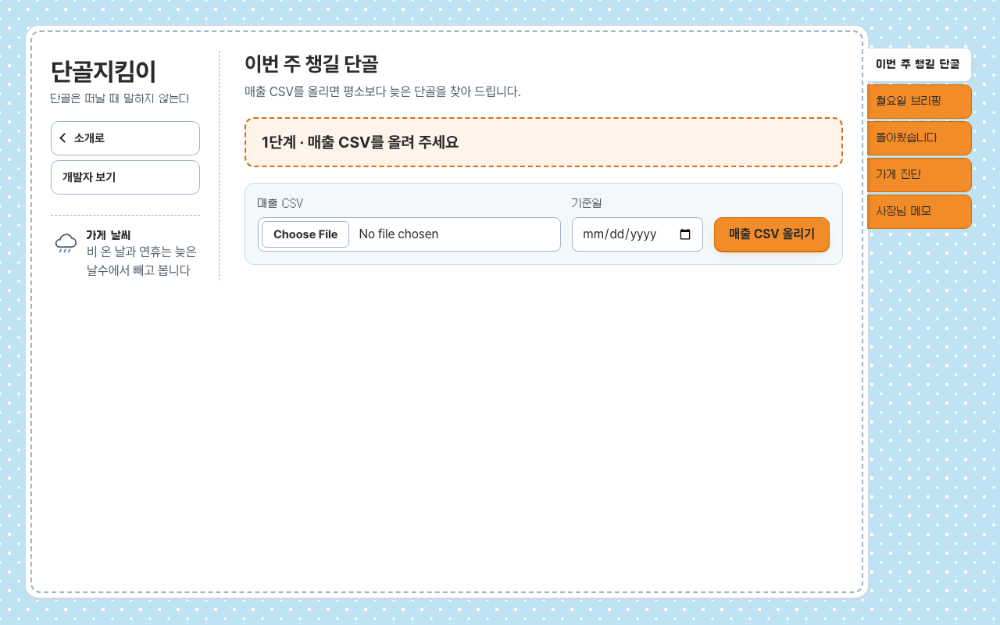</td>
    <td>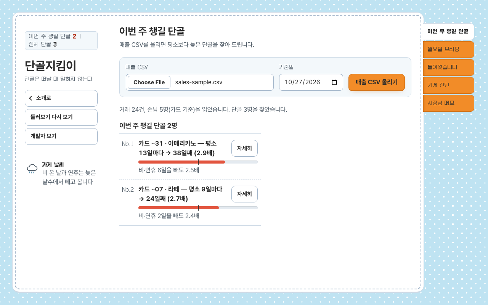</td>
    <td>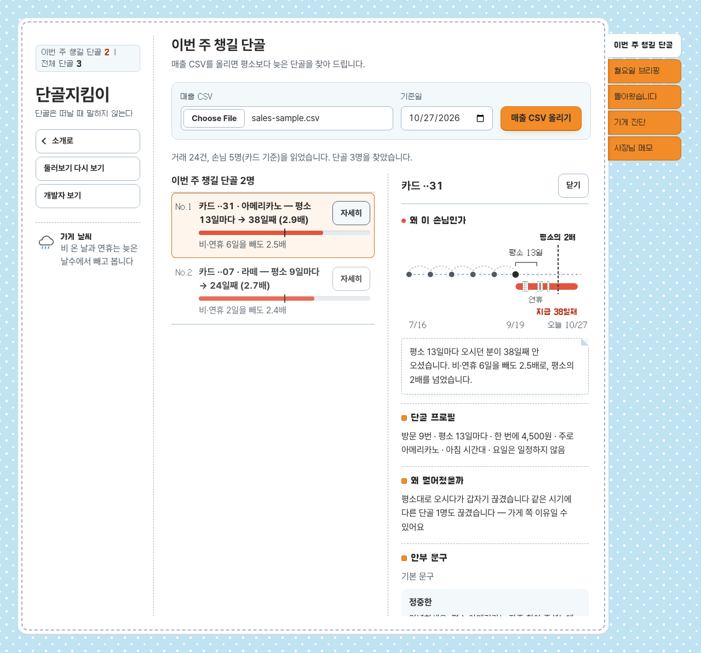</td>
  </tr>
  <tr>
    <td>카드사 사이트에서 내려받은 매출 파일을 첫 화면에 올립니다.</td>
    <td>평소보다 늦어진 단골이 "이번 주 챙길 단골"로 바로 나옵니다.</td>
    <td>손님을 누르면 방문 기록과 그대로 보내도 되는 안부 문구 초안이 열립니다.</td>
  </tr>
</table>

## 기능 한눈에 보기
화면은 탭 5개입니다.

- **이번 주 챙길 단골**: 매출 CSV를 올리면 평소보다 늦은 단골을 찾아 드립니다. 손님을 누르면 방문 기록과 안부 문구 초안이 옆에 열립니다.
- **월요일 브리핑**: 이번 주 챙길 단골과 지난주 돌아온 단골을 한 번에 메신저로 받습니다.
- **돌아왔습니다**: 안부를 전한 단골이 14일 안에 돌아왔는지 확인합니다.
- **가게 진단**: 여러 단골이 같이 뜸해진 이유를 가게 쪽(날씨·리뷰)에서 찾아봅니다. 선택 기능이라 매출 CSV만으로도 챙길 단골은 찾아 드립니다.
- **사장님 메모**: 손님마다 한 줄 메모를 남기면 다음 계산부터 반영됩니다.

### 처음 둘러보기
소개 페이지에서 `앱 열기` 를 누르면 말풍선 3단계가 챙길 단골 목록 → 자세히 → 월요일 브리핑 순서로 화면을 짚어 줍니다.

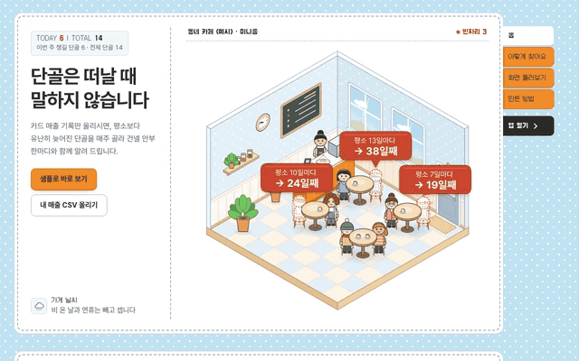

### 왜 이 손님인가
손님을 열면 최근 방문, 평소 간격, 지금까지의 공백, 뺀 공휴일·비 온 날이 한 줄 그림으로 그려지고 판단이 한 문장으로 붙습니다.

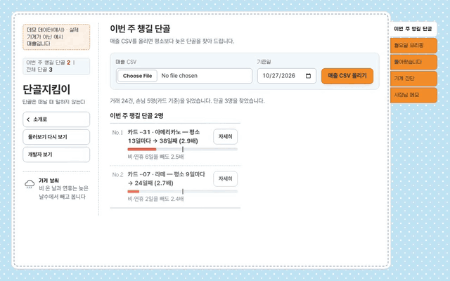

### 가게 진단 (날씨 예시)
`예시 채우기` 로 날씨 기록 형식을 보고 바로 넣어 보면, 비 온 날이 판단에서 어떻게 빠지는지 요약이 나옵니다.

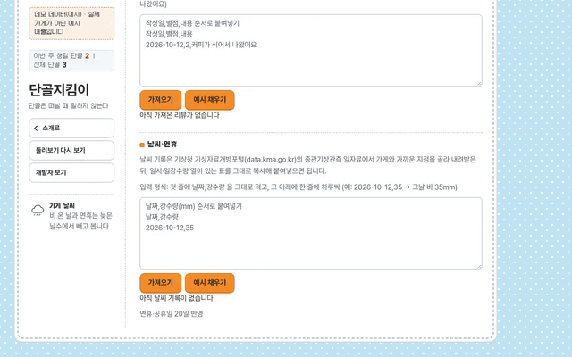

### 월요일 브리핑
이번 주 챙길 단골과 지난주 돌아온 단골이 한 장에 모입니다. 메신저로 받을 수도 있습니다.

### 소개 페이지의 이야기
소개 페이지를 내려 보면 가게 미니룸에서 단골 자리가 하나씩 비어 가고, 이유를 찾고, 안부를 건네고, 다시 돌아오는 이야기가 이어집니다.

### 개발자 보기
머리글의 `개발자 보기` 를 켜면 화면 영역마다 어떤 데이터가 채우는지 작은 주석이 겹쳐 보이고, 끄면 사장님 화면으로 돌아갑니다.

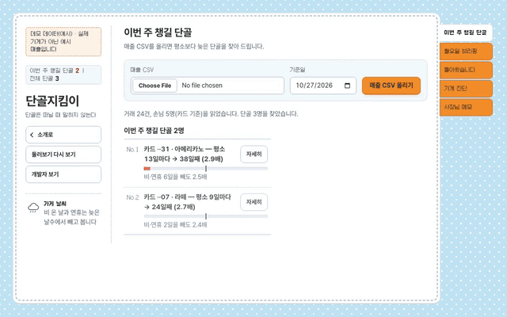

화면 7장 크게 보기

| 화면 | 모습 |
|------|------|
| 이번 주 챙길 단골 | 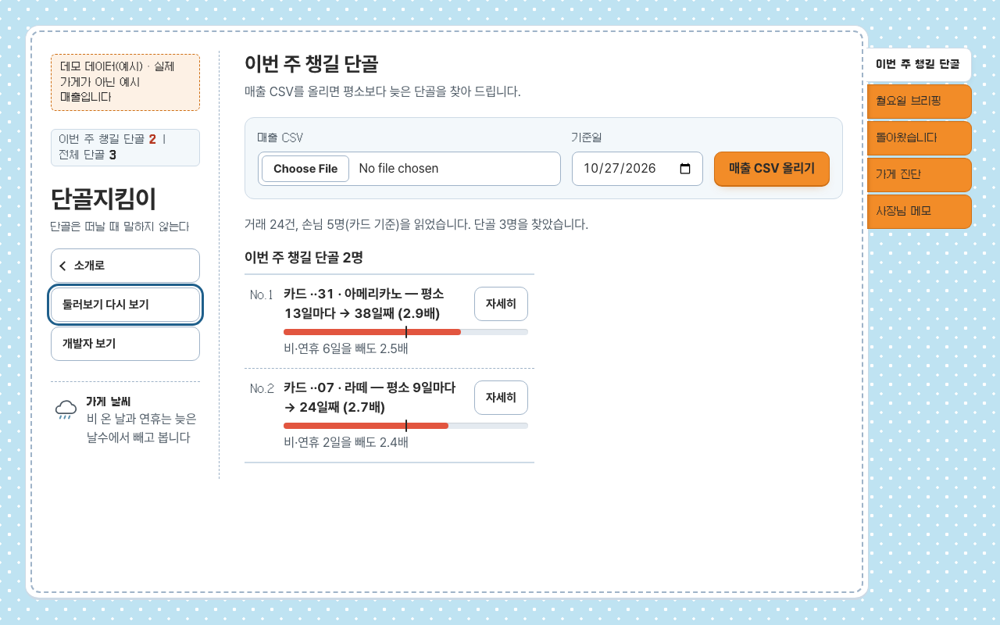 |
| 손님 자세히 보기 | 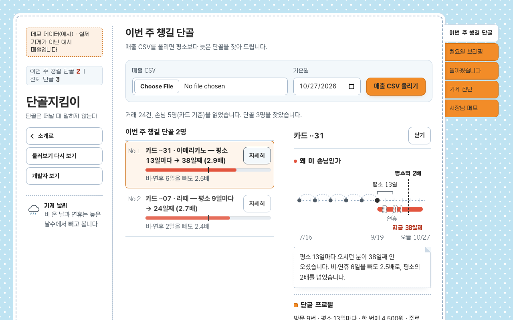 |
| 월요일 브리핑 | 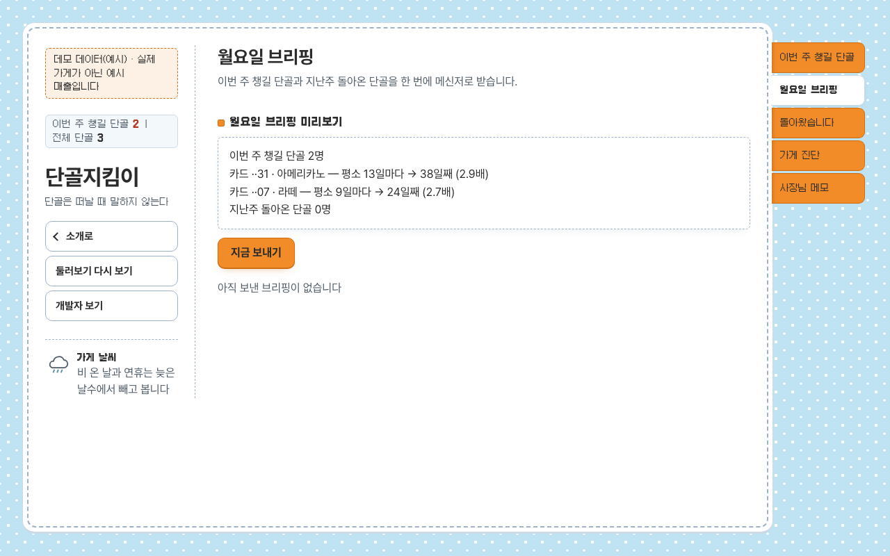 |
| 가게 진단 | 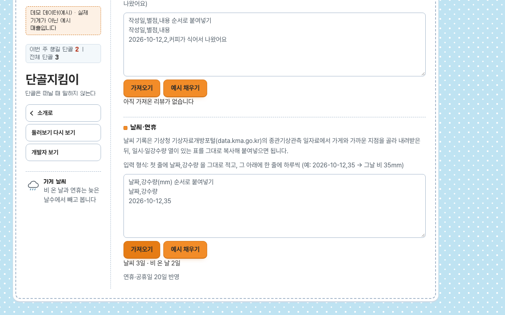 |
| 처음 둘러보기 | 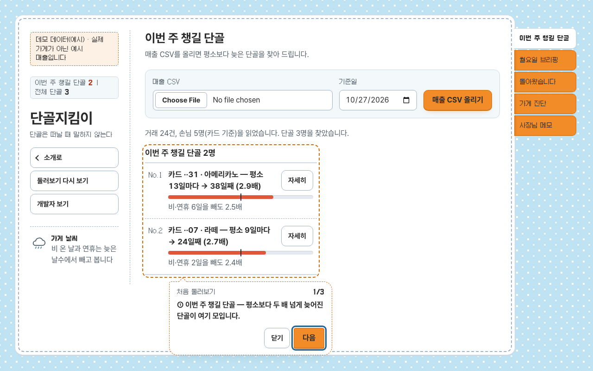 |
| 왜 이 손님인가 | 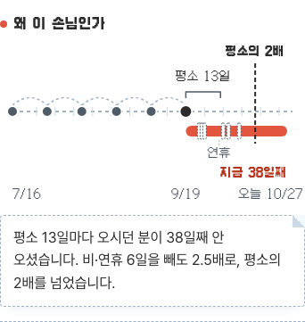 |
| 개발자 보기 | 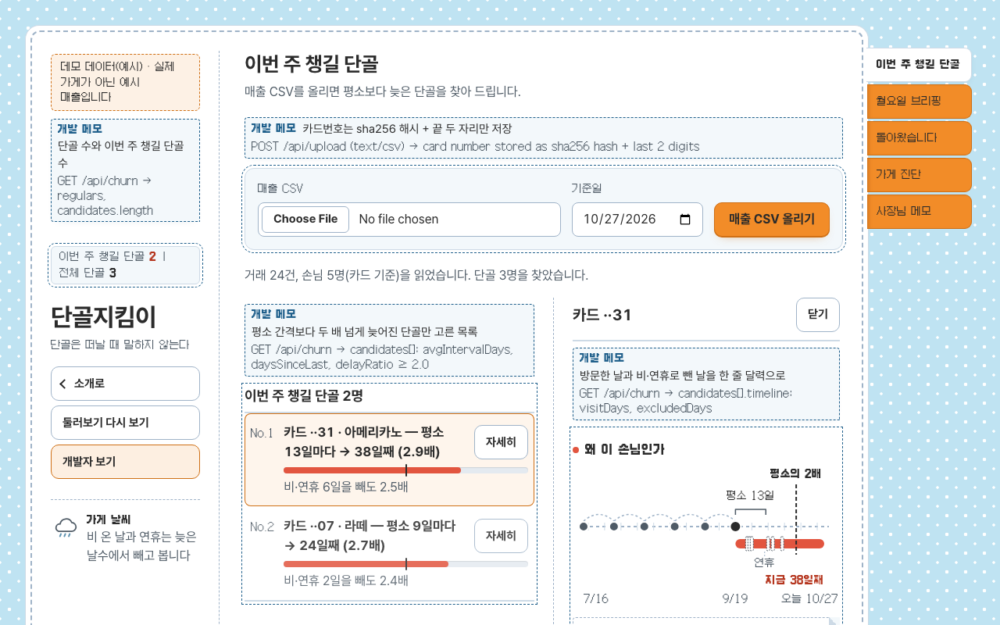 |

- **처음 둘러보기**: 소개에서 `앱 열기`·`샘플로 바로 보기` 로 들어오면 말풍선 3단계(챙길 단골 목록 → 자세히 → 월요일 브리핑)가 화면을 짚어 줍니다. 닫거나 마치면 이 기기에서는 다시 뜨지 않고, 머리글의 `둘러보기 다시 보기` 로 언제든 다시 볼 수 있습니다. 화면 위 `데모 데이터(예시)` 띠가 지금 보는 것이 예시 매출임을 알려 줍니다.
- **왜 이 손님인가**: 손님 자세히 보기 맨 위에 최근 방문 점, 평소 간격, 지금까지의 공백, 뺀 공휴일·비 온 날, 평소의 2배 기준선을 한 줄 그림으로 그리고, 그 아래에 판단을 한 문장으로 적습니다. (예: 평소 13일마다 오시던 분이 38일째 안 오셨습니다. 비·연휴 6일을 빼도 2.5배로, 평소의 2배를 넘었습니다.)
- **개발자 보기**: 머리글의 `개발자 보기` 를 켜면 화면 영역마다 그 자리를 채우는 API 와 필드(예: `GET /api/churn → candidates[].timeline`)가 작은 주석으로 겹쳐 보입니다. 끄면 주석은 화면에서 완전히 사라지고, 사장님 화면에는 기술 용어가 남지 않습니다.

화면과 GIF 는 합성 예시 데이터로 scripts/make-demo-gif.sh 와 scripts/make-feature-gifs.sh 가 만든 것입니다

## 소개 페이지
소개 페이지: 처음 여는 주소(`/`)는 미니홈피처럼 꾸민 가게 미니룸에서 단골 자리가 하나씩 비어 가는 이야기를 보여 줍니다. 위쪽 폴더 탭이 목차(`홈` · `이렇게 찾아요` · `화면 둘러보기` · `만든 방법`)이고, 따로 칠한 `앱 열기` 탭과 각 칸 끝의 `앱 열기` 버튼은 예시 가게를 채운 앱(`/app?sample=1&tour=1`)을 열어 3단계 처음 둘러보기를 띄웁니다. `샘플로 바로 보기` 도 같은 둘러보기로 이어집니다. `화면 둘러보기` 칸의 카드 5개(챙길 단골 · 브리핑 · 돌아왔습니다 · 가게 진단 · 사장님 메모)는 예시 가게가 채워진 그 화면(`/app?sample=1#<탭>`)으로 바로 들어갑니다. 앱 머리글의 `소개로` 를 누르면 언제든 소개 페이지로 돌아옵니다.

<table>
  <tr>
    <td width="72%">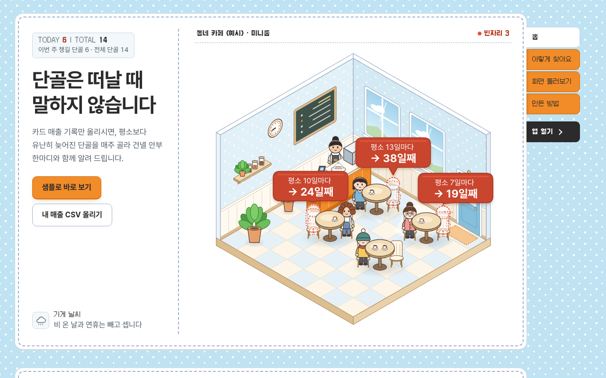</td>
    <td width="28%">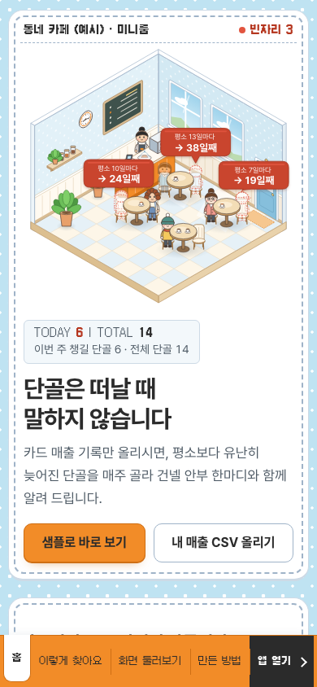</td>
  </tr>
</table>

`만든 방법` 칸은 개발 케이스 스터디입니다. 문제 → 판단 방식 → 코드로 그린 구조 그림 → 실제 테스트 수 → 쓴 기술 순서로, 구조 그림은 스크롤하면 단계가 차례로 이어집니다.

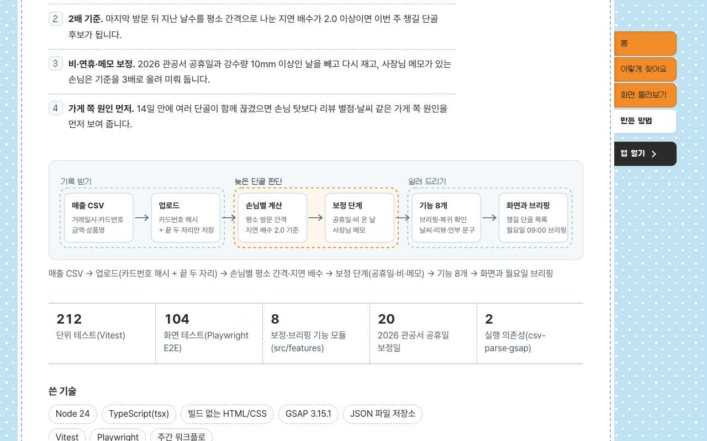

## 자주 묻는 질문

**Q. 손님 개인정보가 걱정됩니다.**
카드번호는 저장하지 않습니다. 올리는 즉시 알아볼 수 없는 값(해시)으로 바꾸고 화면에는 끝 두 자리만 남깁니다. 이름·전화번호는 아예 받지 않고, 데이터는 가게 컴퓨터의 폴더에만 저장됩니다.

**Q. 데모에 나오는 손님은 진짜인가요?**
아닙니다. 데모의 매출과 손님은 모두 만들어 낸 예시 데이터입니다. 공개 데모에 올린 파일은 방문자마다 따로 보관되어 그 브라우저에서만 보이고, 늦어도 24시간 뒤 지워집니다.

**Q. 비용이 드나요?**
가게 컴퓨터에서 돌리면 따로 드는 비용이 없습니다. 문구를 다듬는 키가 없어도 기본 문구로 모든 기능이 돌아갑니다. 공개 데모는 쓰는 사람이 있을 때만 켜지는 방식이라 비용이 거의 들지 않고, 그래서 첫 접속이 몇 초 늦을 수 있습니다.

---

> 여기부터는 개발자용 설명입니다.

## 문제
- 사장님은 단골을 얼굴로 기억하지만 "요즘 안 보이네"를 늦게 깨닫는다
- POS에는 결제 기록이 다 있는데 아무도 분석하지 않는다
- 기존 CRM은 설정이 복잡하고 대형 프랜차이즈용이다

## 판단 방식
복잡한 점수 대신 손님마다 "평소 몇 일에 한 번 오던 분인지"를 기준으로 봅니다.

- **평소 간격 대비 지연 배수**: 마지막 방문 뒤 지난 날수를 그 손님의 평소 방문 간격으로 나눕니다. **2.0배 이상** 늦으면 챙길 단골로 올립니다. (예: 평소 13일마다 오던 분이 38일째 안 오면 2.9배)
- **비·연휴 보정**: 2026 공휴일과, 사장님이 날씨 기록을 넣었다면 비 온 날(강수량 10mm 이상)을 지난 날수에서 뺍니다. 빼고 나서도 2.0배 이상일 때만 올리고, 아니면 "날씨 영향일 수 있어 이번 주는 보류"로 따로 보여 드립니다.
- **메모 보정**: 메모에서 "챙길 단골에서 빼기"를 고르면 보류로 옮겨지고, "원래 뜸한 분 (기준 3배)"을 고르면 그 손님만 기준을 3배로 올립니다.
- **14일 복귀 확인**: 안부를 전한 날부터 14일 안에 결제가 있으면 "돌아왔습니다"에 표시합니다.

## 개인정보
- 카드번호는 저장하지 않습니다. 올린 즉시 해시로 바꾸고, 화면에 보여 줄 끝 두 자리(`카드 ··31`)만 남깁니다.
- 이름·전화번호는 받지 않습니다. 메모에 전화번호로 보이는 숫자를 적으면 저장을 막습니다.
- 데이터는 가게 컴퓨터의 폴더에만 저장됩니다.

## 구조
사장님 화면에는 기술 용어가 나오지 않습니다. 아래는 개발자용 설명입니다.

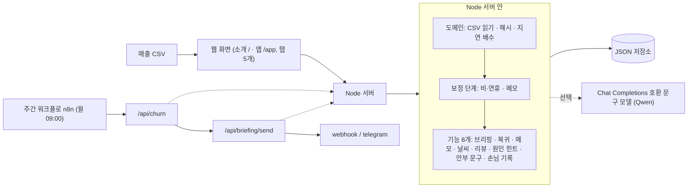

- 주간 알림은 n8n 워크플로가 매주 월요일 09:00 에 `/api/churn` 으로 챙길 단골을 받아 `/api/briefing/send` 로 브리핑을 보냅니다.
- `/api/churn` 의 `candidates[]`·`heldBack[]` 항목마다 `timeline`(`visitDays`: 방문일 전체, `excludedDays`: 마지막 방문 뒤 기준일까지 뺀 공휴일·비 온 날)을 붙여, 상세의 "왜 이 손님인가" 그림이 서버 판단과 같은 자료로 그려집니다. 기존 필드는 값·순서 그대로입니다.
- 안부 문구·답글은 문구 모델 키가 있으면 다듬은 문구, 없으면 기본 문구로 나옵니다. 키가 없어도 모든 기능이 돕니다.

### 화면 구성
- 주소 두 개: `/` 는 소개 페이지(`src/web/landing.html`), `/app` 은 사장님이 쓰는 앱(`src/web/index.html`). 둘 다 같은 미니홈피 틀(하늘 점무늬 바탕, 다이어리 틀, 폴더 탭)을 씁니다.
- 빌드 도구 없이 HTML·CSS·JS 파일을 그대로 서빙합니다. 공용 스타일과 모션은 `/static/` 아래 파일(`theme.css`, `motion.js` 등)로 나눴습니다.
- 모션은 GSAP 3.15.1 (ScrollTrigger 포함)을 `node_modules` 에서 `/vendor/gsap/` 로 직접 서빙합니다. 외부 CDN 을 쓰지 않아 인터넷이 없는 가게 컴퓨터에서도 같은 화면이 나옵니다. 기기에서 "움직임 줄이기"를 켜면 모션 없이 바로 보입니다.
- 웹폰트는 Galmuri11(제목·숫자)과 Pretendard(본문)를 `/static/fonts/` 에 함께 넣었습니다. 두 글꼴 모두 SIL OFL 1.1(SIL Open Font License) 이며 라이선스 원문을 같은 폴더에 동봉합니다.
- 앱 머리글에는 `소개로` · `둘러보기 다시 보기` · `개발자 보기` 가 탭 바 밖에 따로 있고, 스크롤해도 화면 안에 남습니다. 둘러보기(`tour.js`), 판단 그림(`why.js`), 개발자 보기(`devview.js`)는 각각 작은 정적 스크립트입니다.
- `/app?sample=1` 은 데이터가 비어 있을 때만 샘플 매출 CSV(`/static/sample/sales-sample.csv`)를 올려 바로 보여 줍니다. 이미 올린 매출이 있으면 덮어쓰지 않습니다.

| 폴더 | 내용 |
|------|------|
| `src/domain/` | CSV 읽기, 카드번호 해시, 평소 간격과 지연 배수 계산 |
| `src/core/` | 보정 단계 연결, 복귀 확인, 기준일, 문구 모델 호출, JSON 저장 |
| `src/features/` | 기능 8개 (`briefing` `returns` `memos` `weather` `reviews` `hint` `draft` `profile`). 기능마다 계산·주소·화면 조각이 한 폴더에 있습니다 |
| `src/http/` | 주소 연결과 요청 처리 |
| `src/web/` | 사장님이 보는 화면 두 장: 소개 페이지(`landing.html`)와 앱(`index.html`) |
| `src/web/static/` | 공용 스타일·모션(`theme.css` `motion.js`), 소개·앱 전용 스타일과 모션, 미니룸 그림, 웹폰트와 라이선스, 샘플 매출 CSV |
| `workflows/` | 월요일 09:00 주간 알림 워크플로 |
| `scripts/` | 주간 알림 점검, 데모 다시 만들기 |
| `tests/` | 단위 테스트, 화면 테스트(E2E), 샘플 CSV |

## 실행 방법
1. 설치: `npm ci && npx playwright install chromium`
2. 실행: `npm run dev` 후 브라우저에서 엽니다.
   - 소개 페이지: http://localhost:8790/
   - 앱: http://localhost:8790/app
   - 샘플로 바로 보기: http://localhost:8790/app?sample=1 (데이터가 비어 있을 때 샘플 매출로 채워 보여 줍니다)
   - 처음 둘러보기: http://localhost:8790/app?sample=1&tour=1 (샘플을 채운 뒤 3단계 둘러보기를 띄웁니다. 한 번 닫으면 이 브라우저에서는 다시 뜨지 않으니, 다시 보려면 머리글의 `둘러보기 다시 보기` 를 누릅니다)
   - 개발자 보기: http://localhost:8790/app?sample=1&dev=1 (열자마자 개발자 보기를 켭니다. 머리글 버튼으로 끄고 켤 수 있습니다)
   - 쿼리 없이 `/app` 으로 열면 샘플도 둘러보기도 없이 빈 화면과 안내부터 나옵니다.

   프로젝트 폴더에 `.env` 가 있으면 `npm run dev` 가 자동으로 읽습니다.
3. 매출 CSV 를 올립니다. 첫 줄은 `거래일시,카드번호,금액,상품명` 4열입니다.
   - 예: `2026-06-07 08:10:00,1234-56**-****-7831,4500,아메리카노`
4. 주간 알림 점검: `npm run smoke:workflow` (Docker 필요). 월요일 09:00 알림 흐름을 기준일 `2026-10-27` 로 한 번 돌려, 점검 스크립트가 잠깐 띄운 수신기가 `이번 주 챙길 단골` 과 `지난주 돌아온 단골` 이 들어간 브리핑을 받아야 통과합니다.

## 데이터 구하는 법
- **매출 CSV**: 카드사 가맹점 사이트의 매출 내역 내려받기 파일을 `거래일시,카드번호,금액,상품명` 4열로 맞춰 올립니다. 카드번호는 가려진 형태(`1234-56**-****-7831`) 그대로 괜찮습니다.
- **날씨**: 기상자료개방포털의 일자료(지역 선택 후 일강수량)를 내려받아 가게 진단 탭에 붙여넣습니다. 첫 줄 `날짜,강수량` 또는 포털 열 이름(`일시`, `일강수량(mm)`) 그대로 되고, 쉼표 대신 탭으로 나뉜 표를 복사해 붙여도 됩니다.
  - 예: `2026-10-13,30`
- **리뷰**: 배달·지도 앱의 리뷰 관리 화면에서 작성일·별점·내용을 옮겨 첫 줄 `작성일,별점,내용` 으로 붙여넣습니다. 별점은 1~5입니다.
  - 예: `2026-09-20,2,커피가 식어서 나왔어요`
- 날짜는 `2026-09-20`, `2026.09.20`, `2026/09/20` 모두 됩니다. 가게 진단 탭의 "예시 채우기" 버튼으로 형식을 먼저 볼 수 있습니다.

## 설정 값 (환경변수)
값은 프로젝트 폴더의 `.env` 에 적고, `.env` 는 커밋하지 않습니다. 아무것도 적지 않아도 동작합니다. 문구 키가 없으면 안부 문구·답글은 기본 문구로 나오고, 브리핑 채널을 고르지 않으면 보낸 기록만 남습니다.

| 이름 | 기본값 | 설명 |
|------|--------|------|
| `STORE_NAME` | `저희 가게` | 안부 문구·답글에 들어갈 가게 이름 |
| `LLM_API_KEY` | 없음 | 문구를 자동으로 다듬을 때 쓰는 키. 없으면 기본 문구 |
| `LLM_BASE_URL` | `https://dashscope-intl.aliyuncs.com/compatible-mode/v1` | 문구 생성 서비스 주소 (Chat Completions 호환) |
| `LLM_MODEL` | `qwen3.7-flash` | 문구 생성 모델 이름 |
| `PUSH_CHANNEL` | `none` | 브리핑을 보낼 곳: `webhook` · `telegram` · `none` |
| `PUSH_WEBHOOK_URL` | 없음 | `webhook` 일 때 브리핑을 받을 주소 |
| `PUSH_TELEGRAM_TOKEN` | 없음 | `telegram` 일 때 봇 토큰 |
| `PUSH_TELEGRAM_CHAT_ID` | 없음 | `telegram` 일 때 받을 대화방 번호 |
| `REGULARS_TODAY` | 없음(오늘 날짜) | 기준일 고정 (`YYYY-MM-DD`). 데모·점검을 언제 돌려도 같은 결과가 나오게 합니다. 형식이 틀리면 경고 후 오늘 날짜 |
| `PORT` | `8790` | 화면을 여는 포트 |
| `REGULARS_DATA_DIR` | `data` | 데이터를 저장할 폴더 |
| `REGULARS_HASH_SALT` | `dev-salt` (경고 출력) | 카드번호 해시에 섞는 값. 실제 가게에서는 꼭 바꿔 적습니다 |
| `REGULARS_DEMO_MODE` | 없음(꺼짐) | `1` 이면 공개 데모 모드. 방문자마다 쿠키로 데이터 폴더를 나눠(`<REGULARS_DATA_DIR>/visitors/<방문자>`) 서로의 매출이 보이지 않고, 앱 업로드 칸 위에 "예시 파일만" 안내가 나옵니다 |
| `REGULARS_DEMO_TTL_HOURS` | `24` | 데모 모드에서 방문자 데이터를 남겨 두는 시간. 마지막 사용 뒤 이 시간이 지나면 지웁니다 |
| `REGULARS_DEMO_SWEEP_MINUTES` | `30` | 데모 모드에서 오래된 방문자 데이터를 찾아 지우는 간격(분) |
| `REGULARS_DEMO_MAX_VISITORS` | `100` | 데모 모드에서 남겨 두는 방문자 수 상한. 넘으면 가장 오래 안 쓴 방문자부터 지웁니다 |

### 월요일 브리핑 받을 곳 정하기
- 기본은 webhook 입니다. `PUSH_CHANNEL=webhook` 과 `PUSH_WEBHOOK_URL=<받을 주소>` 를 적으면 "지금 보내기"와 월요일 09:00 에 브리핑 내용(JSON)을 그 주소로 보냅니다. 메신저 봇이나 업무 도구의 수신 주소를 넣으면 됩니다.
- 텔레그램으로 받으려면 `PUSH_CHANNEL=telegram`, `PUSH_TELEGRAM_TOKEN`, `PUSH_TELEGRAM_CHAT_ID` 를 적습니다.
- 아무 곳도 연결하지 않으면(`none`) 브리핑은 보낸 기록과 알림 기록만 남고 실제로 전송되지는 않습니다.

## 2026 공휴일 기준
비·연휴 보정에 쓰는 2026 공휴일은 20일이며 「관공서의 공휴일에 관한 규정」을 따릅니다.
- 제2조 공휴일 + 제9회 전국동시지방선거일 2026-06-03(수)을 넣습니다.
- 대체공휴일: 3/1→3/2, 5/24(부처님오신날)→5/25, 8/15→8/17, 10/3→10/5. 추석 연휴(9/24~9/26)는 일요일과 겹치지 않아 대체 없음, 현충일은 대체 대상 아님.
- 근로자의 날(5/1)과 제헌절(7/17)은 관공서 공휴일 목록에 없어 넣지 않습니다.
- 최종 20일: 1/1, 2/16, 2/17, 2/18, 3/1, 3/2, 5/5, 5/24, 5/25, 6/3, 6/6, 8/15, 8/17, 9/24, 9/25, 9/26, 10/3, 10/5, 10/9, 12/25.

## 테스트
- 타입 검사: `npm run typecheck`
- 단위 테스트: `npm test`
- 화면 테스트(E2E): `npm run e2e`
- 데모 모드 화면 테스트: `npx playwright test -c playwright.demo.config.ts` (포트 8805 에 데모 모드 서버를 띄워 방문자 분리·쿠키·24시간 정리·업로드 안내를 확인합니다. `npm run e2e` 와 동시에 돌리지 않습니다)

<!-- counts --> 단위 테스트 20개 파일 212건 · E2E 21개 파일 95건 · 데모 모드 E2E 1개 파일 9건

## 배포 (Cloud Run)
개발자용 설명입니다. 공개 데모는 Google Cloud Run 에 컨테이너 하나로 올립니다. 데모 모드(`REGULARS_DEMO_MODE=1`)로 돌고, 문구 모델 키와 브리핑 전송 설정은 넣지 않습니다(기본 문구, 전송 없음).

### 컨테이너
- 빌드: `docker build -t regulars-crm:local .`
- 로컬 실행: `docker run --rm -p 8806:8790 -e REGULARS_DEMO_MODE=1 -e REGULARS_HASH_SALT=<임의 값> regulars-crm:local` 후 http://localhost:8806/ 을 엽니다.
- 이미지는 `node:24-alpine` 에 운영 의존성과 `src/` 만 담습니다. Node 24 가 TypeScript 타입을 바로 지워 실행하므로 빌드 단계가 없습니다. 상태 확인 주소는 `/health` 입니다(Cloud Run 은 `/healthz` 를 앱에 넘기지 않습니다).

### 처음 한 번 준비
- `deploy/gcp/setup.sh`: API 켜기, 이미지 저장소(최근 2개만 남기는 정리 규칙 `deploy/gcp/ar-cleanup-policy.json`), 실행용·배포용 서비스 계정, GitHub 키 없는 인증(Workload Identity), 비밀 `REGULARS_HASH_SALT`, 권한 연결을 만듭니다. 있는 자원은 건너뜁니다.
  - 사용: `GCP_PROJECT_ID=<프로젝트 ID> GCP_REGION=asia-northeast3 GITHUB_REPO=<owner>/<repo> bash deploy/gcp/setup.sh [--dry-run|--resources-only|--verify]`
  - `--verify` 는 읽기만 해서 항목마다 ✓/✗ 를 찍고, 모두 갖춰지면 `SETUP OK` 로 끝납니다. 끝에 GitHub 저장소에 넣을 변수 5개(`GCP_PROJECT_ID` `GCP_REGION` `ARTIFACT_REPO` `GCP_WIF_PROVIDER` `GCP_DEPLOY_SA`)를 출력합니다.
- `deploy/gcp/apply-env.sh`: 첫 배포와 설정 반영. 비밀 값이 없을 때만 무작위 값을 넣고(값은 출력하지 않음), `deploy/gcp/service.yaml` 을 채워 `gcloud run services replace` 로 서비스를 만든 뒤 `/health` 가 `{"ok":true}` 면 `APPLY OK` 를 찍습니다.
  - 사용: `GCP_PROJECT_ID=<프로젝트 ID> IMAGE=<이미지> bash deploy/gcp/apply-env.sh [--dry-run] [--allow-public-iam]`

### 자동 배포
1. `main` 에 push 하면 `ci` 워크플로가 타입 검사 → 단위 테스트 → E2E → 데모 모드 E2E 를 순서대로 돌립니다.
2. `ci` 가 성공하면 `deploy` 워크플로가 키 없는 인증으로 로그인해 이미지(`linux/amd64`, 태그는 커밋 해시)를 빌드·push 하고 `gcloud run deploy` 로 이미지만 바꿉니다. 환경변수·비밀·자원 설정은 `service.yaml` 쪽 값을 그대로 둡니다.
3. 마지막으로 공개 주소의 `/health` 를 확인합니다. 서비스가 아직 없으면 안내만 남기고 성공으로 끝납니다(첫 배포는 `apply-env.sh`).

### 비용 원칙
- 인스턴스는 0~1개(`minScale 0`, `maxScale 1`), 요청을 처리할 때만 CPU 를 씁니다. 아무도 안 쓰면 0개로 내려가 비용이 거의 들지 않고, 그래서 첫 접속이 몇 초 늦을 수 있습니다. 깨워 두는 주기 호출(keepalive)은 두지 않습니다.
- 메모리 512Mi, 동시 요청 40, 요청 제한 60초. 이미지 저장소는 최근 2개만 남깁니다.
- 방문자 데이터는 인스턴스 안 폴더에만 있어서 인스턴스가 내려가면 함께 사라집니다. 데모라서 이것으로 충분합니다.

## 데모 다시 만들기
`bash scripts/make-demo-gif.sh` 를 실행하면 `assets/demo.gif` 와 화면 10장(소개 페이지 넓은 화면·휴대폰, 이번 주 챙길 단골, 손님 자세히 보기, 월요일 브리핑, 가게 진단, 처음 둘러보기, 왜 이 손님인가, 만든 방법, 개발자 보기)을 다시 만듭니다. ffmpeg 와 chromium 이 필요합니다. 기준일 `2026-10-27`, 빈 데이터 폴더, 문구 키 없이(기본 문구) 찍어서 언제 돌려도 같은 화면이 나옵니다.

`bash scripts/make-feature-gifs.sh` 를 실행하면 기능별 GIF 6개(`assets/gifs/`)와 3단계 화면 3장(`assets/screenshots/step-*.png`)을 다시 만듭니다. 장면마다 빈 데이터 폴더로 포트 8796 에 서버를 새로 띄워 녹화하고, 문구 키 없이(기본 문구) 찍습니다. 마찬가지로 ffmpeg 와 chromium 이 필요합니다.

## 하지 않는 것
- 포인트 적립 앱, 고객 가입 유도
- 광고 메시지 대량 발송

## MVP
- CSV 업로드 방식으로 시작, POS 연동은 다음
- 매장 1곳 실제 데이터로 4주 운영
- 알림 받은 손님 중 복귀율 측정
- 현재 상태: 샘플 데이터로 검증했고, 실제 매장 운영은 아직입니다
